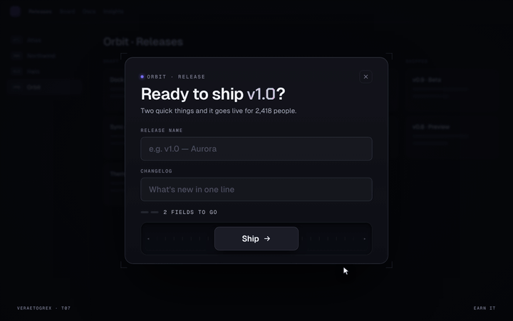

# Earn It

**The Ship button runs away until you've earned it.**



**Live demo:** [veraetogrex-portfolio.github.io/earn-it](https://veraetogrex-portfolio.github.io/earn-it/) · **Mockup:** [full-screen version](https://veraetogrex-portfolio.github.io/earn-it/mockup/earn-it.html)

The Ship button runs from the pointer while the form is empty. Every filled field makes it slower to flee, and when both are done it comes home and lets you ship.

## Use it

Three files, no build step, no dependencies, no web fonts:

```
index.html   markup
style.css    styles and keyframes
script.js    behaviour
```

Download the repo and open `index.html`, or copy the three files into your project.

## Try it

- Chase the button with an empty form.
- Fill “Release name” and “Changelog” and it settles down.
- The button is never `disabled`: `Tab` + `Enter` always work.

## Make it yours

Hint texts are the `HINTS` array in `script.js`. The ship action is `shipIt()`: put your release call there. Colours are CSS custom properties at the top of `style.css`.

`prefers-reduced-motion` is respected: heavy motion drops to short fades.

## What's in `mockup/`

The full 1440×900 screen this component was shot in for the reel:

- `mockup/earn-it.html` — interactive. `D` plays the demo, `R` resets.
- `mockup/earn-it.autoplay.html` — the scripted ~6 s loop with a drawn cursor.
- URL flags: `?frame` puts the screen in a browser window, `?clean` hides the control panel, `?once` plays the demo once.

The mockup uses a shared stage runtime and bundled fonts from `mockup/_shared/`. The component in the root doesn't need any of it.

---

Component 07 of a series. New one every day on Instagram [@veraetogrex_portfolio](https://www.instagram.com/veraetogrex_portfolio/) · all components: [github.com/veraetogrex-portfolio](https://github.com/veraetogrex-portfolio)

MIT licensed.
